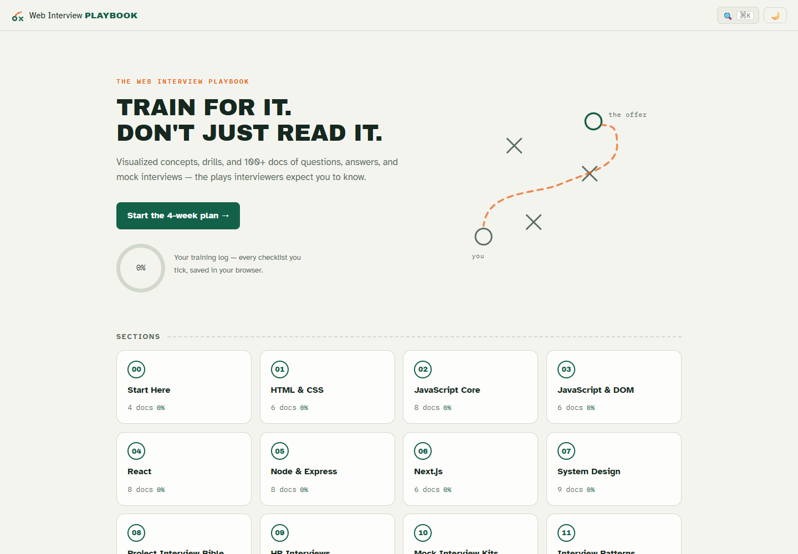
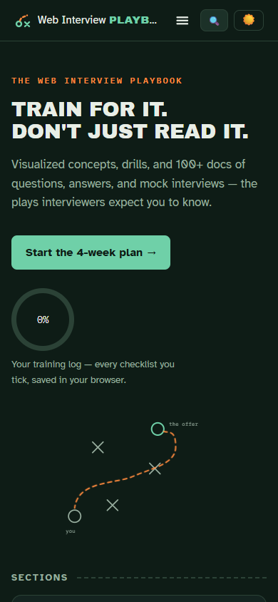

# The Web Interview Playbook

**Train for it. Don't just read it.**

A web-development interview guide you can practice with: predict an output before revealing its answer, step through a concept, rehearse a story and run a timed mock round. It is aimed at students preparing for internships and junior web roles.



The [written guide](web-dev-interview-playbook/README.md) stands on its own. The Astro site turns that same Markdown into searchable lessons, practice tools and a browser-local training log.

## Choose your practice

| Need | Start here |
| --- | --- |
| A study plan | The four-week roadmap and persistent daily checkboxes |
| Technical intuition | Section visualizers: event loop, layout, React, APIs and system design |
| Output questions | Type a prediction before unlocking the explanation |
| Behavioral answers | STAR story builder, timed rehearsal and text export |
| A rehearsal round | Mock-interview clocks, self-scoring and attempt history |

Search works in the production build; progress, drafts and attempts stay in the current browser. Clearing browser storage can erase them. Export anything you want to keep. These are teaching models and self-assessment tools, not an assessment of hiring readiness or a job guarantee.

## Try it locally

Install Git and **Node.js 24+** with npm. Node 24 on Windows was used for the local walkthrough; the verification workflow also selects Node 24. No account, API key or backend is needed.

```sh
git clone https://github.com/Muneer320/The-Web-Interview-Playbook.git
cd The-Web-Interview-Playbook/site
npm ci
npm run build
npm run preview
```

Open **http://localhost:4321**. Search for `closure`, tick a roadmap day and reload, then try **STAR Answer Builder** or **Timed Mock Interview Simulator**. Use a sample story to explore saving and export.

<details>
<summary><strong>Phone-sized view</strong></summary>



</details>

## How it fits together

The Markdown corpus is the content source; Astro builds the pages and interactive React tools, and Pagefind indexes the generated HTML. Browser storage keeps practice local. A last-change badge is Git history metadata, not proof that every technical answer is current.

For development, `npm run dev` starts Astro; search becomes available after a production build. `npm run test` runs the existing Vitest suite. See [site setup and deployment](site/README.md), [authoring tools and content](site/AUTHORING.md), and the [contribution guide](web-dev-interview-playbook/CONTRIBUTING.md).

The two tools that restore personal browser state mount on the client, avoiding a mismatch between a prebuilt empty page and saved stories/attempts. Their surrounding explanations and source-document links remain static; JavaScript is required for the tools.

## Status, deployment and credits

Kept as a useful learning project after source, unit-test, build and real-browser review. The local checks cover search, roadmap/theme persistence, prediction gates, story save/export, mock start/pause/score and saved-attempt reload, plus desktop/mobile navigation. They do not certify every answer or every visualizer's scientific accuracy.

This repository's Pages source is the `gh-pages` branch. Publishing details and the separate collaborator staging branch are explained in the [site notes](site/README.md); a source commit alone does not update generated Pages output.

Original guide work by [Mrinal Bhattacharya](https://github.com/mrinal1224), interactive site work by [Om Midya](https://github.com/Om-Midya), and responsive/site improvements by [Muneer Alam](https://github.com/Muneer320), as recorded in Git history. All contributor history is preserved. No project-wide license file is present; no reuse license is asserted here. Contact the contributors about reuse permissions.
